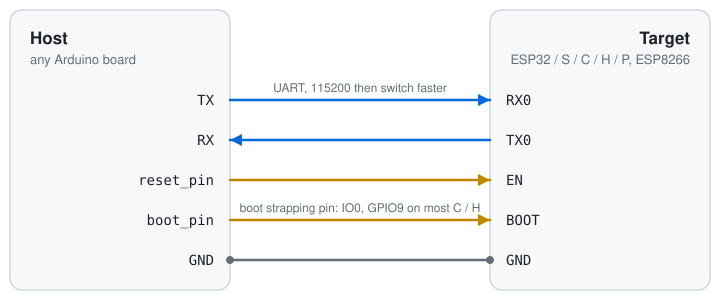

<div align="center">

# EspSerialFlasher

**Flash Espressif chips from another Arduino board.**<br>
Connect two UART wires and two GPIOs, then flash an ESP32 from your sketch.

[](https://github.com/Dzarda7/EspSerialFlasher/actions/workflows/build.yml)
[](https://github.com/Dzarda7/EspSerialFlasher/releases/latest)
[](https://github.com/espressif/esp-serial-flasher)
[](LICENSE)



</div>

## Features

- ⚡ **Flash** with erase, write and MD5 verify. It switches to a faster baud rate after connecting.
- 🧩 **Flasher stub** for every Espressif chip, or only the ones you need.
- 🔍 **Inspect** the target: chip, MAC, flash size, security info, registers, and flash read-back.
- 🧠 **RAM load**, compressed (deflate) flashing and eFuse access through the same API.
- 📦 **Pay for what you use.** The ROM-loader-only build adds about 9 KB of flash.

This is [esp-serial-flasher](https://github.com/espressif/esp-serial-flasher), Espressif's C
library for flashing their chips from any host. It is included unmodified with a small Arduino
UART port, so the whole `esp_loader_*` API works from a sketch.

## Getting started

1. Install the library:
   - **Arduino IDE**: download the zip from the
     [latest release](https://github.com/Dzarda7/EspSerialFlasher/releases/latest), then go to
     **Sketch → Include Library → Add .ZIP Library…**
   - **PlatformIO**: `lib_deps = https://github.com/Dzarda7/EspSerialFlasher.git#v0.0.0`
2. Wire the boards as shown above.
3. Open **File → Examples → EspSerialFlasher → FlashFromFile**. Set your pins and upload.

```cpp
#include <EspSerialFlasher.h>

ArduinoFlasherPort port;
esp_loader_t loader;

void setup()
{
    Serial1.begin(115200, SERIAL_8N1, RX_PIN, TX_PIN);  // the ROM bootloader starts at 115200

    port.serial = &Serial1;
    port.reset_pin = TARGET_EN;
    port.boot_pin = TARGET_BOOT;

    esp_loader_init_serial(&loader, &port.port);
    esp_loader_connect_args_t args = ESP_LOADER_CONNECT_DEFAULT();
    esp_loader_connect_with_stub(&loader, &args);
    esp_loader_change_transmission_rate(&loader, 460800);

    esp_loader_flash_cfg_t cfg = {};
    cfg.offset = 0x10000;
    cfg.image_size = image_size;
    cfg.block_size = 1024;
    esp_loader_flash_start(&loader, &cfg);
    // esp_loader_flash_write(&loader, &cfg, block, len) for each block ...
    esp_loader_flash_finish(&loader, &cfg);  // checks the MD5

    esp_loader_reset_target(&loader);
}
```

Every call returns an `esp_loader_error_t`. `flasher_error_string()` turns it into text. See
[`esp_loader.h`](src/esp_loader.h) for the full API.

## Port options

Set these fields of `ArduinoFlasherPort` before calling `esp_loader_init_serial()`:

| Field | Default | |
|---|---|---|
| `serial` | – | Your `HardwareSerial`, already started with `begin()` |
| `reset_pin`, `boot_pin` | `-1` | GPIOs connected to the target's EN and BOOT. Use `-1` if a pin isn't connected |
| `reset_invert`, `boot_invert` | `false` | Set if a transistor in between inverts the signal |
| `reset_hold_ms`, `boot_hold_ms` | `100`, `50` | Pulse timing for entering the bootloader |
| `log` | `nullptr` | A `Print` for library logs, e.g. `&Serial` |

## Binary size

The linker drops everything the sketch doesn't call. Measured on ESP32:

| Connect with | Adds |
|---|---|
| `esp_loader_connect()`, ROM loader only | ~9 KB |
| `esp_loader_connect_with_stub()`, stubs for every chip | ~124 KB |
| `esp_loader_connect_with_stub_provider()` with one chip | ~16 KB |

To link only the stubs you need:

```cpp
#include <esp_loader_stubs.h>

static const esp_stub_t *my_stubs(esp_loader_t *, target_chip_t chip, void *)
{
    switch (chip) {
    case ESP32C3_CHIP:
        return &esp_stub_esp32c3;
    case ESP32S3_CHIP:
        return &esp_stub_esp32s3;
    default:
        return nullptr;  // connect fails with ESP_LOADER_ERROR_UNSUPPORTED_CHIP
    }
}

esp_loader_connect_with_stub_provider(&loader, &args, my_stubs, nullptr);
```

## Supported hardware

| | |
|---|---|
| **Targets** | ESP32, ESP32-S2, S3, C2, C3, C5, C6, C61, H2, P4, ESP8266 and newer |
| **Hosts** | 32-bit Arduino cores with a `HardwareSerial` (ESP32, RP2040, STM32, SAMD, …). AVR boards are too small |
| **Tested** | ESP32-C6 host flashing an ESP32 |

## Logging

The library's own log output is compiled out by default. To turn it on, build with
`-DSERIAL_FLASHER_LOG_LEVEL=1`…`4` (ERROR…DEBUG), for example with PlatformIO `build_flags`,
and set `port.log`. Level 4 dumps every packet in hex. That is slow enough to make flashing
time out, so use it only when debugging.

## Development

Everything in `src/` except `EspSerialFlasher.*` is upstream code. Don't edit it. To move to
another upstream release:

```sh
./update.sh v2.1.0
```

This clones that tag, replaces the upstream files and records it in `UPSTREAM_VERSION`.

Commits follow [Conventional Commits](https://www.conventionalcommits.org/) (run
`pre-commit install` once). A release is `cz bump && git push --follow-tags`; CI then publishes
it.

## License

[Apache-2.0](LICENSE), the same as esp-serial-flasher. The bundled flasher stubs are
Apache-2.0 OR MIT.
